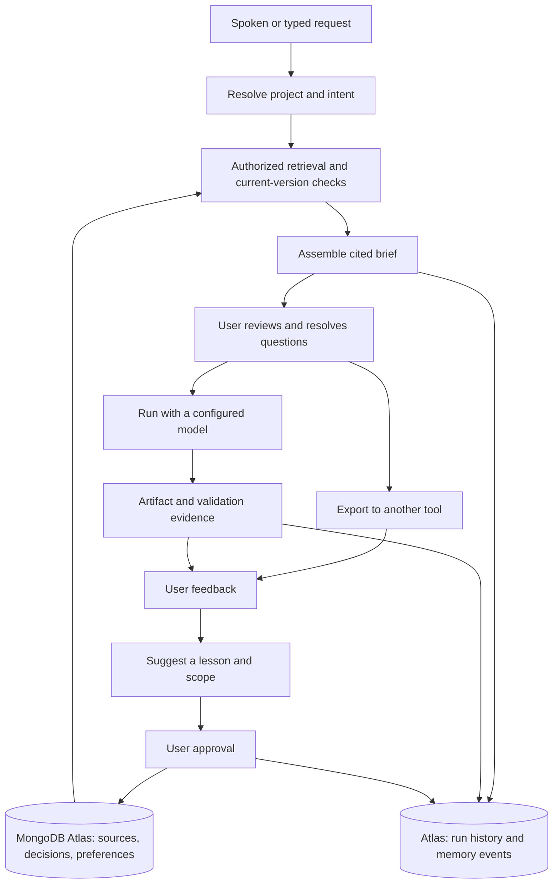

# PromptForge

**Say what you want to build. PromptForge brings the context your team already has.**

PromptForge turns a loose spoken or typed request into a grounded, inspectable brief for an AI model. It combines project sources, shared team decisions, and approved preferences so you spend less time reconstructing context and steering the same work again.

Review and export the brief to your coding tool, or run it with a selected model inside PromptForge. When you give feedback, PromptForge suggests a reusable lesson. You decide whether to save it for yourself, the project, or the team.

**Hackathon track:** Memory You Can Govern · MongoDB Agents in Context · Toronto, November 14, 2026.

> **Status:** Early prototype scaffold. This README defines the current product direction and intended experience; the complete workflow is not implemented yet. Website generation is a candidate first workflow, and the final demo is still to be chosen. See [implementation status](#implementation-status) before running the project.

## The problem

AI-assisted teams repeatedly explain things their organization already knows: which spec is current, why an API changed, how the product should look, and what went wrong last time. That knowledge is scattered across documents, repositories, conversations, and individual agent sessions.

A capable model can still produce the wrong result when it receives an incomplete or outdated picture. Each teammate then spends time correcting work that another teammate has already explained.

PromptForge makes that context reusable, attributable, and correctable across sessions. Its first users are small product and engineering teams working with AI on a shared codebase or product.

The team's knowledge lives independently of any single conversation or model. Changing coding tools should not mean rebuilding the team's context from scratch.

## The product

**One request → relevant team context → an inspectable brief → a model result → approved learning.**

For example:

> “On that project doc, can we build the signup page? Keep it consistent with what we decided.”

The intended experience:

1. **Understand the request.** Resolve the project, document, and requested feature. If two documents or features fit, ask one focused question.
2. **Find the context.** Retrieve the relevant spec, current decisions, applicable code references, and approved preferences within the caller's access.
3. **Build the brief.** Explain the objective, requirements, constraints, dependencies, and acceptance checks. Cite sources and surface unresolved questions.
4. **Let the user inspect it.** Show which decisions and preferences shaped the brief. The user can edit it, export it, or send it to a configured model.
5. **Return work to review.** Present the generated artifact and available validation evidence. For a website, this could be a preview; for a code workflow, a diff and test results.
6. **Learn with permission.** Turn feedback such as “we always need a mobile layout” into a proposed lesson. The user chooses its scope before it affects future work.

The goal is a useful first result with fewer repeated corrections. Prompt length, token savings, and first-attempt success are measurements to evaluate, not guarantees.

An illustrative brief for that signup request might carry three distinct instructions: use the identity service named in the approved architecture decision, include the fields required by the current signup spec, and follow the project's approved button-label preference. Each instruction points back to its source. If the spec leaves a required field undefined, the brief surfaces that question before generation.

## What goes into a brief

The brief is the product's central artifact. It should be useful whether PromptForge executes it or another coding tool receives it.

| Part | What it contains |
| --- | --- |
| Objective | The user's intended outcome and the resolved project or feature |
| Requirements | Behavior the result must satisfy, with source references |
| Current decisions | Applicable decisions, their owners, and their revisions |
| Implementation context | Relevant interfaces, files, conventions, and dependencies when available |
| Preferences | Approved guidance selected for this user, project, task, and model |
| Acceptance checks | Concrete ways to determine whether the work meets the request |
| Open questions | Missing information, unresolved conflicts, and explicit assumptions |
| Provenance | The source and memory revisions used to assemble the brief |

PromptForge should preserve a requirement even when a shorter prompt would omit it. It should flag an unknown file or interface rather than invent one.

## Shared context and learned preferences

PromptForge keeps different kinds of knowledge distinct:

| Knowledge | Example | How it is maintained |
| --- | --- | --- |
| Source context | A feature spec or a repository snapshot | Linked to a source and revision; refreshed when that source changes |
| Team decisions | “The signup flow uses the existing identity service.” | Attributed to an authorized owner; corrected or superseded explicitly |
| Preferences | “For this project, use concise button labels.” | Suggested from feedback and approved at a chosen scope |
| Outcome evidence | A user's correction or a recorded check result | Attached to the run and the specific observation it supports |

**A preference does not silently override a requirement.** A newer chat message does not automatically supersede an approved decision. If applicable sources disagree and no authorized correction resolves them, PromptForge surfaces the conflict.

### Learning from feedback

The learning loop improves the context and instructions supplied to the model; it does not train the model's weights.

1. The user reviews a result and gives specific feedback.
2. PromptForge proposes a lesson, shows its evidence, and checks for a duplicate or conflicting memory.
3. The user approves, edits, or rejects the lesson and chooses its scope.
4. Future relevant requests can retrieve that approved lesson in a fresh session.
5. Later evidence can trigger a suggested correction, retirement, or re-evaluation.

Personal lessons guide that person's work. Project lessons apply to members of that project. Team lessons require permission to publish guidance for the team. Broader visibility always requires an explicit choice.

A vote for a whole artifact is a preference signal. It does not prove that every instruction used in that artifact caused the win. Where comparisons are used, capture a reason and keep the lesson tentative until approved. Track relevance and evidence by task and model instead of assuming a lesson works everywhere.

## Memory you can govern

MongoDB Atlas is the intended store for context, memory, and run state. Atlas Vector Search retrieves relevant meaning; application rules determine whether a memory is authorized, current, and applicable.

| Control | Required behavior |
| --- | --- |
| Access | Derive identity and membership from the session. Restrict retrieval to authorized team, project, and personal scopes before semantic search. Apply equivalent checks to source reads, run history, exports, and writes. |
| Approval | Keep suggested lessons separate from approved memory. Enforce who may publish or correct guidance at each scope. |
| Attribution | Record the source, author or approver, scope, revision, and supporting run where applicable. |
| Correction | Preserve explicit supersession relationships. Only the current authorized version may influence a new brief. |
| Expiry | Exclude expired memory when reading it. TTL cleanup alone is insufficient because deletion runs in the background. |
| Forgetting | Remove a memory from future use and invalidate affected derived context. Do not claim complete erasure while its text remains in stored briefs, events, or artifacts. |
| Run evidence | Record which source and memory revisions shaped a brief, which model received it, and what validation actually ran. |

Before execution, recheck the selected memory's current authorization, status, and revision against the authoritative records. If a decision changed after the brief was prepared, show the change and refresh the brief.

Correction and erasure have different retention needs. A correction may retain its history for explanation; an erasure workflow must address retained copies and derived content under an explicit retention policy. This prototype does not yet implement a complete erasure workflow.

References: [Atlas Vector Search filtering](https://www.mongodb.com/docs/vector-search/query/aggregation-stages/vector-search-stage/#mongodb-vector-search-filtering) and [MongoDB TTL behavior](https://www.mongodb.com/docs/manual/core/index-ttl/#behavior).

## The experience we are building

The main screen is a place to delegate work and review the result.

- **Project setup:** Supply a spec, relevant repository snapshot, and explicit decisions; review their source, owner, and scope. These establish the starting context before the first request.
- **Request:** Choose a project, speak or type a request, and review the transcript.
- **Context:** Inspect the selected sources, decisions, and preferences, with their attribution and scope.
- **Brief:** Review or edit the assembled instructions; resolve blocking questions; export or run.
- **Result:** Inspect the generated artifact and validation evidence. A failed or unrun check remains visible.
- **Feedback:** Explain a correction and decide whether the proposed lesson should be remembered.

The brief should remain usable without an execution integration. Running it inside PromptForge is a second path through the same context and review flow.

## Hackathon scope

The product direction is settled: **shared team context plus approved learning, with both brief export and model execution.** The demo scenario and final output format remain open. Website generation is the leading candidate because its result can be inspected quickly.

### First complete workflow

- One project with a small, curated set of source documents and explicit team decisions.
- Typed requests, with voice input when the core loop works.
- Atlas-backed memory and Vector Search with enforced access scopes.
- A cited brief that can be reviewed and exported.
- One configured generation model and one supported artifact type.
- Feedback that becomes a suggested lesson with an explicit scope and approval.
- A fresh run showing an approved lesson or corrected decision affecting the result.
- A second team's fixtures to verify isolation.

Start with supplied documents and repository snapshots. Live ingestion of everyone's agent sessions is a later integration, with explicit connection and sharing controls.

### Later expansion

The full product includes model selection; the first complete workflow only needs one working adapter. Later expansion adds more adapters, live document and repository connectors, coding-tool handoff, automated validation for more artifact types, and broader learning from outcome evidence. A/B generation is an optional way to gather feedback; it is not required for the core workflow.

## How we will prove it works

The demo should establish a visible connection between a memory change and a result. Its exact task is still to be chosen.

1. Run a fixed request and show the sources and memories used.
2. Approve a specific lesson or correct a team decision in a separate session.
3. Repeat the same request in a fresh session, using the same model configuration and starting artifact or repository revision.
4. Show the changed brief, the cited memory revision, and an observable difference in the result.
5. Verify that expired, superseded, unapproved, and unauthorized memories are excluded.

Use a requirement or distinctive project preference with a concrete check. Do not rely on a general claim that the second result looks better. Repeated trials and a memory-disabled comparison can help distinguish the effect from generation variance; a single pair of outputs is demo evidence, not a causal benchmark.

We will report requirement satisfaction, retained constraints, user corrections, time to a reviewable result, and validation outcomes. Any token or latency comparison must state its baseline. Fixtures and prerecorded fallback runs must be identified as such.

## Planned architecture



The prototype uses only **MongoDB Atlas** and the event's partner resources: an **ElevenLabs agent** (voice or text) is the only LLM and writes the brief, reaching Atlas solely through PromptForge's governed API as webhook tools; **Voyage AI** provides embeddings and reranking; **LangSmith** traces retrieval and each agent tool step. FastAPI serves the API and a plain HTML/JavaScript frontend. Secrets stay on the server. The brief is exported as Markdown to the user's coding tool, such as Claude Code.

### Planned records

| Record | Purpose |
| --- | --- |
| Identity and membership | Establish who may read, execute, approve, and publish at each scope |
| Sources and decisions | Preserve project context, provenance, current revisions, and supersession |
| Lessons | Store proposed or approved preferences with scope, evidence, status, and expiry |
| Runs | Record the request, assembled brief, context revisions, model, artifact, and check results |
| Feedback | Preserve the user's observation and any lesson it proposed |
| Memory events | Explain approvals, corrections, scope changes, retirement, and forgetting without retaining content that must be erased |

The collections are `users`, `projects`, `sources`, `decisions`, `lessons`, `runs`, `feedback` and `memory_events`. See [docs/DESIGN.md](docs/DESIGN.md#data-model).

## Implementation status

**Workflow implemented and tested offline; not yet verified against the Atlas Sandbox, ElevenLabs, Voyage or LangSmith.** Follow [Local development](#local-development) to verify.

| Area | Current state |
| --- | --- |
| Request | A conversation with the ElevenLabs agent, by voice or typed (text-only mode). The agent asks one clarifying question when two documents or features fit |
| Agent ↔ Atlas | Five webhook tools: `get_project_context`, `save_brief`, `record_feedback`, `approve_lesson`, `reject_lesson`. Each call carries a short-lived session token passed as a `secret__` dynamic variable, which ElevenLabs never sends to the LLM; identity, team and project come from that token, never from the model |
| Context | Scoped `$vectorSearch` (Voyage embeddings) over source chunks, current decisions and approved lessons; source chunks reranked with Voyage rerank; hits re-checked against the collections because search indexes sync asynchronously |
| Brief | Written by the agent with `[S1]`-style citations; unknown citations dropped and uncited items flagged; shown live on screen; editable; blocking questions must be resolved before export |
| Export | Cited memory rechecked first (stale → refused with the change shown); Markdown with a provenance list, downloaded and copied for Claude Code or any coding tool |
| Result | The user records which acceptance checks the externally built result meets; unmarked checks stay "not run" |
| Learning | Feedback (spoken to the agent or typed) becomes a proposed lesson with duplicate and conflict hints; approval at personal, project or team scope is a separate, explicit step (team needs publisher/admin) |
| Governance | Revisions and supersession, retire, forget (marks citing runs stale, logs without text), expiry sweep before reads with TTL purge later, append-only `memory_events` with a JSON Schema validator |
| Tracing | LangSmith traces for context gathering, Voyage calls, and each pipeline step when `LANGSMITH_TRACING=true` |
| Tests | 24 offline tests (scope filters, lifecycle, brief parsing, full agent-tool HTTP flow with external calls stubbed); 3 live Atlas tests that run once `.env` is configured and fixtures are seeded |

Not implemented: running the brief with a model inside PromptForge (no partner credit covers generation; the brief is exported instead), live document or repository connectors, automated validation of results, and a complete erasure workflow.

[docs/DESIGN.md](docs/DESIGN.md) maps this README to the data model, API and modules. The earlier website-voting design is archived in [docs/archive/](docs/archive/website-voting-design.md).

### Repository layout

```text
backend/
  app/main.py          FastAPI application (API under /api, frontend at /)
  app/routes/          UI endpoints, voice session, and agent_tools.py (ElevenLabs webhook tools)
  app/agent/           Pipeline: retrieval (Voyage), brief parsing/export, memory recheck
  app/repo/            Scope filters and scoped data access (the only path to Atlas)
  tests/               Offline tests and live Atlas isolation tests
frontend/              Conversation → brief → export → result → feedback, with a project-context sidebar
scripts/               Atlas setup, ElevenLabs agent setup, seeding, and demo fixtures
docs/                  Technical design; archive/ holds the earlier prototype design
skills/                Repository-specific development instructions
```

### Local development

From the repository root:

```bash
python3 -m venv .venv
source .venv/bin/activate
python -m pip install -r backend/requirements.txt
cp .env.example .env                    # MONGODB_URI (Atlas Sandbox), VOYAGE_API_KEY, ELEVENLABS_API_KEY, LANGSMITH_API_KEY
python scripts/setup_atlas.py           # collections, validator, indexes, 3 Vector Search indexes, TTL
python scripts/seed.py --reset          # demo fixtures (embedded with Voyage)
uvicorn app.main:app --reload --app-dir backend
cloudflared tunnel --url http://localhost:8000   # in another terminal; put the https URL in PUBLIC_BASE_URL
python scripts/setup_elevenlabs_agent.py         # creates the agent + tools; put ELEVENLABS_AGENT_ID in .env, restart uvicorn
# open http://localhost:8000, choose a demo user, and start talking
```

ElevenLabs calls the tools over the public tunnel URL, so the tunnel must stay up during the demo; re-run the agent setup if its URL changes. For the hackathon, provision the cluster through the supplied Atlas Sandbox invitation.

```bash
pytest backend/tests                    # offline tests; live Atlas tests run when .env is set and fixtures are seeded
```

## Team ownership

| Workstream | Owns |
| --- | --- |
| Context and memory | Atlas Sandbox, source records, retrieval, access scopes, approval, correction, and expiry |
| Brief and execution | Intent resolution, cited brief assembly, export, one model adapter, and result evidence |
| Product experience | Request input, context inspection, brief review, result display, and scoped feedback |
| Verification and demo | Curated fixtures, acceptance checks, isolation verification, demo scenario, and submission |

## Hackathon submission

The event requires the supplied **MongoDB Atlas Hackathon Sandbox** for finalist eligibility, a **public repository**, a **one-minute demo video**, and a concise project description. The demo must clearly identify the functionality built during the event. Submissions close at **5:00 PM Toronto time on November 14, 2026**.

Before submission, replace the prototype status with verified capabilities, identify the team's original contributions and third-party dependencies, confirm video playback and demo access, and include every team member. The current scaffold is not a completed submission.

See the [official event resource guide](https://docs.google.com/document/d/1rrsNKU3guyvExg_oBPpfOrZF9Ypr5xPLFQ9yYJ2C60o/edit).

## License

MIT. See [LICENSE](LICENSE).
